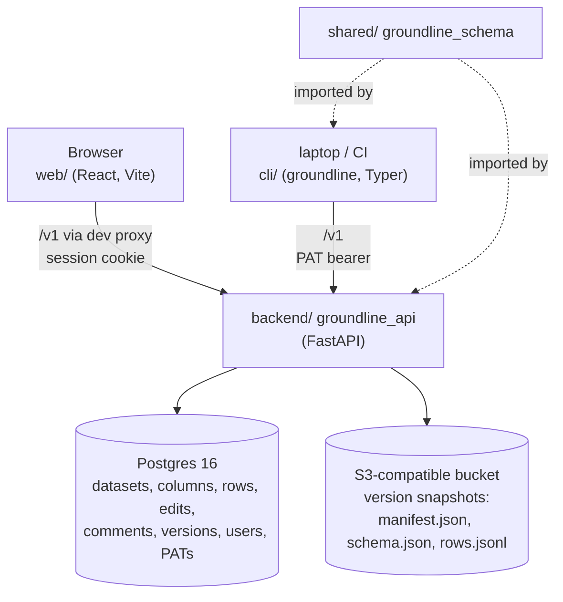

# Architecture

Groundline is a tabular annotation tool that produces versioned evaluation
datasets. Teams define a typed column schema, fill and review rows in a web
grid (or sync them from files with the CLI), then cut immutable versions that
code and CI pull by `name@vN` with hash verification.

## Components

| Dir | Package | Role |
|---|---|---|
| `shared/` | `groundline_schema` | Column types, `Column` model, manifest, JSON Schema sidecar, dotted-path flatten/nest, JSON/JSONL/YAML record parsing, export rendering, date helpers. One source of truth so API and CLI never disagree. |
| `backend/` | `groundline_api` | FastAPI app under `/v1`, SQLAlchemy models, Alembic migrations, auth, domain services. |
| `cli/` | `groundline_cli` (script `groundline`) | Pull versions with a lock file, diff, schema infer/pull/push, row pull/push/delete. |
| `web/` | Vite + React 19 + TS | Login, dataset list, annotation grid, import wizard, versions panel, API tokens page. |
| `infra/` | — | `docker-compose.yml` (Postgres, RustFS object storage, API container, mock OIDC), `Dockerfile`, Entra setup notes. |

Layer details: [database.md](database.md), [backend.md](backend.md),
[frontend.md](frontend.md), [cli.md](cli.md). Feature-to-code map:
[features.md](features.md).

## Core data flow

1. **Schema.** An editor creates a dataset and `PUT`s its column list
   (`/v1/datasets/{id}/schema`). Columns are never hard-deleted; absent keys
   are archived. Column keys may be dotted paths (`expected.answer`) that stand
   for nested fields.
2. **Rows.** Rows are stored flat in `dataset_rows.data` (JSONB keyed by column
   key). Every write is validated against the schema
   (`services/validation.py`). Rows come from the grid, the import wizard
   (CSV/XLSX/JSON/JSONL/YAML, create-only) or CLI sync (key-matched upsert).
3. **Review.** Each row has `status` (`draft → needs_review → approved`), an
   optional `assignee`, a comment thread and an append-only edit log
   (`row_edits`). Concurrent edits use optimistic locking (`rev` + `If-Match`,
   409 on mismatch).
4. **Version.** An editor cuts a version (`POST /versions`). By default only
   approved rows go in. The rows are serialised to canonical JSONL, hashed
   (`sha256`), and written with the schema and manifest to object storage
   under `datasets/{name}/v{n}/`. Versions are immutable and never deleted.
5. **Consume.** Export and CLI `pull` always read the stored snapshot, never
   live rows. The CLI verifies `content_hash` before writing files and records
   the pin in `groundline.lock`; `groundline pull --lock` restores every pin
   in CI.

## Auth model

- **Interactive:** signed session cookie `groundline_session`
  (`auth/sessions.py`, HMAC with `APP_SECRET_KEY`, 12h). It is issued by
  either the passwordless dev login (`POST /v1/auth/login`, only when
  `APP_ENV=dev` and `AUTH_DEV_LOGIN=true`; the app refuses to start
  otherwise) or Entra OIDC SSO (`/v1/auth/sso/login` → `/callback`, PKCE,
  JIT-provisioning with role from group claims via `ROLE_MAPPING`).
- **Machine:** personal access tokens `glpat_…` sent as
  `Authorization: Bearer`. Only the sha256 is stored. A token acts as its user
  with that user's role. The `scopes` column exists but is not enforced.
- **Roles** (`viewer < annotator < editor < admin`, `deps.require_role`):
  viewer reads and pulls; annotator edits row data/status/assignee and
  comments; editor also changes schema, imports, syncs, deletes rows/datasets,
  changes a row's key value and cuts versions; admin also manages users.

## Invariants worth knowing before you change code

- Versions are immutable: storage writes use `If-None-Match: *`, there is no
  delete endpoint, and a dataset with any version can't be deleted (409).
- Dataset `name` is unique and is used as the storage key segment and the
  CLI's `name@vN`. Endpoints take the dataset **id**; the CLI resolves names.
- Deleted rows are soft-deleted (`deleted_at`). They disappear from lists,
  versions, sync, pull and key uniqueness, but keep data and edit history.
- At most one active **key column** per dataset (text, required). Its value is
  mirrored into `dataset_rows.row_key` with a partial unique index; CLI sync
  matches rows on it.
- Export bytes are canonical (sorted keys, compact separators). JSON/YAML and
  the `nested` shape are renderings of the same stored JSONL, so the hash does
  not change with format or shape, and the CLI renders locally with the same
  code (`groundline_schema.render`).
- `date` values are `YYYY-MM-DD` strings everywhere, never JS `Date` objects
  or timestamps.
